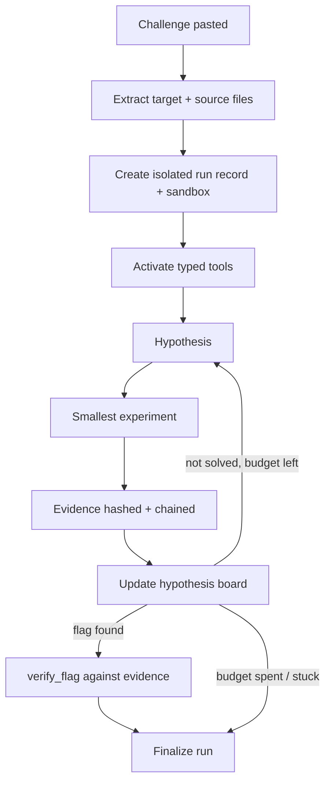

# CTF-C — Autonomous CTF-Solving Agent

An AI agent that solves Capture The Flag security challenges on its own. It reads a
challenge, forms ranked hypotheses, runs small experiments, keeps cryptographically
linked evidence for every step, and stops when it has verified a flag or run out of
budget. Runs in OpenCode, with a Pi coding agent as a subagent through a typed-tool extension, and every action is
confined to a per-run sandbox.

Built for the UCSI Agentic AI CTF Hackathon 2026 and used there by team **Cooked by Code**.

## What it does

- **Works across categories** — web, binary/pwn, and reversing challenges.
- **Reasons in the open** — keeps a ranked board of up to 3 live hypotheses, retires
  the ones the evidence contradicts, and promotes the strongest. Before each step it
  states its leading hypothesis, the supporting evidence, and the smallest experiment
  left to try.
- **Keeps tamper-evident evidence** — every tool output is hashed (SHA-256) and linked
  to the previous one. If the chain breaks, the run aborts.
- **Stays inside a sandbox** — per-run cookie jars, isolated response data, a private
  work directory, and strict same-origin limits. No cross-run state leaks.
- **Respects a budget** — a per-run cap on actions and wall-clock time stops the agent
  from looping forever.
- **Verifies before it claims** — a flag counts only after it is confirmed against
  retained evidence.

## Project status

Stage 2: a Pi extension with 18 typed tools, a structured hypothesis board, the
evidence chain, and an exploration budget.

| Area | Status |
|---|---|
| Web challenges (injection, auth flows, multi-step) | ✅ Solving |
| Binary challenges (source-guided) | ✅ Solving |
| Local binary analysis (`objdump`, `readelf`, `nm`, `strings`, tracing) | ✅ Working |
| Source-file ingestion (auto-detects paths, detects ELF files) | ✅ Working |
| Reversing (dynamic trace, crypto) | ⚠️ Partial |
| Complex pwn (ROP, ASLR) | ⚠️ Partial |
| Interactive debugging (GDB), parallel runs, cross-run memory | ❌ Planned |

## Architecture



**The solve loop:** the agent picks its strongest hypothesis, runs the smallest
experiment that could confirm or kill it, records the result as linked evidence,
updates the board, and repeats until a flag is verified or the budget ends.

### The 18 typed tools

| Tool | Area | Purpose |
|---|---|---|
| `start_competition_run` | Run | Initialize or inspect the private, single-origin run |
| `http_request` | Web | Same-origin GET/POST with isolated cookies |
| `websocket_exchange` | Web | Same-origin WebSocket exchange |
| `browser_action` | Web | Playwright Chromium, limited to the authorized origin |
| `tcp_connect` | Network | Bounded TCP socket to the authorized host |
| `list_source` / `read_source` / `search_source` | Source | Read supplied challenge source, bounded |
| `run_local_command` | Analysis | Read-only profiles: `file`, `strings`, `readelf`, `objdump`, `nm`, tracing, etc. |
| `compute_digest` | Analysis | Deterministic digest of retained bytes |
| `derive_binary_evidence` | Analysis | Derive evidence from retained bytes |
| `write_work_file` / `run_python` | Compute | Write and run a Python script in the sandbox |
| `inspect_evidence` | Evidence | Bounded inspection of retained responses |
| `replace_session_cookie` / `adopt_session_cookie` | Session | Manage a session for the exact target origin |
| `verify_flag` | Result | Confirm a flag in retained evidence |
| `finalize_result` | Result | Persist a terminal non-solved result |

## Getting started

**Requirements:** Node.js ≥ 22, the Pi CLI, and Playwright browsers.

```sh
git clone https://github.com/AungPaingTun/CTF-C.git
cd CTF-C
npm install
npm run install:browser
```

Paste a challenge into an interactive Pi session, or use the scripted runner:

```sh
./scripts/run_competition.sh --target <challenge-url> --approve \
  --description "Full challenge description here"
```

Results land in `.ctf-c/competition-runs/` (git-ignored), one isolated folder per run,
with the result and the full evidence chain.

### Configuration

Set with environment variables or CLI flags.

| Name | Purpose |
|---|---|
| `ACTION_BUDGET` | Max tool calls per run |
| `TIME_BUDGET_MINUTES` | Max wall-clock time per run |
| `CTFC_COMPETITION_INTERACTIVE` | `1` for interactive Pi sessions |
| `CTFC_COMPETITION_INPUT_ROOTS` | Permitted source directories |
| `DEBUG` | Verbose logging when set |

## Project structure

```
.pi/extensions/ctf-c-stage2-core.mjs   Main extension: the 18 tools, run lifecycle, evidence chain
scripts/                               Launchers, ingestion, finalization, tests
challenges/                            Challenge definitions and a template
tests/                                 Test suite (node --test + shell harnesses)
.ctf-c/competition-runs/               Per-run isolated sandboxes (git-ignored)
```

## How it's kept safe

Every run is boxed in:

| Risk | How it's handled |
|---|---|
| Path traversal | Symlinks rejected, every file access checked against the run directory |
| Shell injection | Processes spawned with `shell: false`, arguments passed as a list |
| Runaway tools | OS-level timeouts and output size caps on every tool |
| Reaching other hosts | TCP and HTTP enforced to the one authorized origin |
| State leaking between runs | Per-run cookie jar, evidence, and work directory |
| Evidence tampering | SHA-256 chain; a mismatch aborts the run |

## What I learned

- **An agent needs a rule for giving up on a wrong idea.** The biggest early failure
  was the agent clinging to a disproved theory. The ranked hypothesis board, which
  retires contradicted ideas, was the fix.
- **A budget turns "it loops forever" into "it stops and reports."** Caps on actions
  and time made runs predictable.
- **Evidence you can't trust is worse than none.** Hashing and chaining every tool
  output meant a solved flag was always backed by a verifiable trail.
- **Read the source before poking the target.** For binary challenges, working from the
  supplied source first was far more reliable than probing the live service.

## What I'd build next

- Interactive debugging (a GDB profile) and ROP-chain support for harder pwn challenges.
- Screenshots returned as evidence from the browser tool.
- Memory across runs, so the agent reuses patterns it has seen before.
- Concurrent hypothesis testing and multi-host challenge chains.

## License

MIT — see [LICENSE](./LICENSE).
